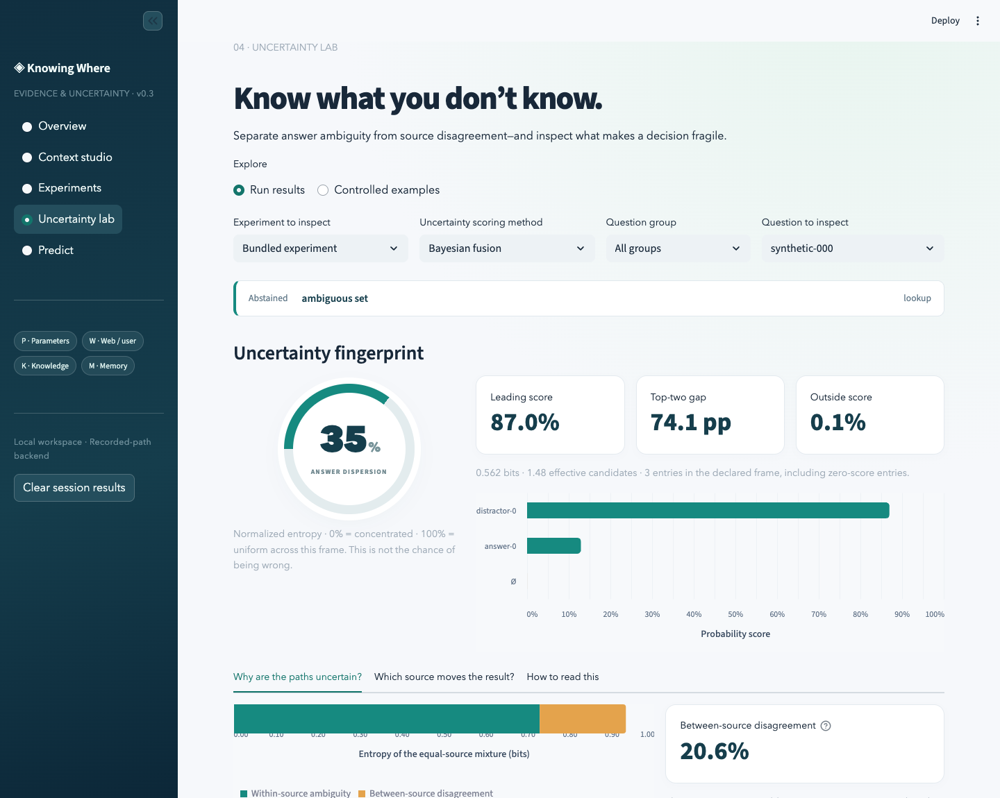

# Streamlit evidence workbench

A local Streamlit app for the context compiler, experiment pipeline, and fitted
prediction system. It uses the existing library functions; the UI does not
implement a separate scoring or calibration policy.

## Install and launch

From the repository root:

```bash
python3 -m venv .venv
source .venv/bin/activate
python -m pip install -e ".[ui]"
python -m streamlit run streamlit_app.py
```

Open the local URL printed by Streamlit, usually `http://localhost:8501`.
The equivalent installation command is `python -m pip install -r requirements.txt`.
UI dependencies are optional; installing the core package without `[ui]` keeps its
standard-library-only runtime. The supported UI uses Streamlit 1.50+ and pandas;
Python's package resolver selects compatible versions for your interpreter.

## Workspaces

| Workspace | What you can do |
| --- | --- |
| Overview | Understand the workflow, inspect the bundled comparison, and learn the P/W/K/M labels. |
| Context studio | Use a sample, upload, or paste a context request; edit the question and routing limits; compile; inspect retained passages, structured conflicts, omissions, exact payloads, and budget sweeps. |
| Experiments | Supply JSONL data and model profiles, configure seed/alpha/path count/call budget, run all five methods, inspect individual held-out cases, and download reports or fitted systems. |
| Uncertainty lab | Quantify answer dispersion, source ambiguity and disagreement, inspect source-removal sensitivity, explore controlled scenarios, and review uncertainty against held-out errors. |
| Predict | Select the bundled system, the latest completed experiment, or an uploaded/pasted artifact; supply label-free queries; inspect prediction sets, source diagnostics, and abstention decisions. |

Try this sequence:

1. Open **Context studio**, keep the sample request, and select **Compile context**.
   Inspect the two latency claims and the model rejected by the cost limit.
2. Open **Experiments** and keep both sample inputs. Explicitly select the
   corpus-absence independence approximation, then select **Run experiment**.
3. Compare answer rates and actual answer set coverage alongside mapped coverage.
   Inspect a test question and its source estimates and conflict diagnostics.
4. Download the report or fitted artifact from **Export**.
5. Open **Predict**, select **Latest experiment**, and run the sample queries.
   The fitted coefficients and calibration thresholds stay frozen.

Inputs can be samples, uploads, or pasted text. Each upload/pasted input is limited
to 10 MB; interactive JSONL datasets and query batches are limited to 1000 rows.
The uploaded JSONL format and artifact contract are documented in the
[experiment guide](../experiments/README.md).

## Session behavior

Runs execute only when their action button is selected. Editing an input does not
silently refit a model or regenerate results. If inputs have changed, a notice
identifies the displayed result as the last completed run. A failed submitted run
clears its previous result rather than presenting it as a successful new run.

Computed results remain in the server's per-user Streamlit session. **Clear session
results** removes computed reports, fitted systems, and predictions. Download
anything you want to retain before the session ends. Uploads and run results are
handled in memory; app actions do not replace repository example files.

The bundled example is synthetic, and the research workspaces run recorded answer
paths. **Live models** separately connects to Hugging Face hosted chat inference.
Neither mode infers missing source-presence labels or claims benchmark accuracy.
The generator budget in the research workspaces counts replay attempts and enforces the same
preflight controls used by the CLI. Backend retries are not exposed in the replay
UI. Estimated routing cost and latency remain caller-supplied model-card values.

## Test

With the optional dependencies installed:

```bash
python -m unittest discover -s tests -v
```

Streamlit's [AppTest framework](https://docs.streamlit.io/develop/api-reference/app-testing)
checks workspace navigation, compilation, conflicts, malformed input handling,
experiment consent, call budgets, experiment-to-prediction handoff, stale-result
notices, and session clearing. UI service tests exercise the existing pipeline and
strict JSON/JSONL input validation. Without Streamlit installed, interface tests
are skipped and the core/service tests remain available.

## Version 0.3 visual and uncertainty upgrade

The interface now uses a navy navigation rail, source badges, teal and amber
charts, softer metric cards, responsive filters, and a compact uncertainty
fingerprint. Fonts use local system families; the visual theme makes no external
font requests. The new lab is documented in the
[uncertainty guide](../uncertainty/README.md).

Both the automated app tests and real Chrome checks cover the lab. Controlled
examples distinguish identical mixture entropy caused by ambiguous sources from
that caused by confident disagreement. These additions describe predictions and
leave the existing learned weights, conformal thresholds, and decisions unchanged.



## Beginner experience and source-first policy prototype

The default **Start here** workspace explains answer absence and retrieval failure
with a librarian example and a worked 100-question calculation. Navigation buttons
open each real workspace, with instructions for running its sample inputs.

New workspaces:

- **Routing simulator** ranks manual, illustrative query-side estimates using
  `(1 - g) * r - penalty * cost`. It selects the highest positive utility, or
  abstains before retrieval. A five-stage control reveals the decision flow.
  Only the selected source has a confidence control. All request counts remain
  explicitly zero because this is a local simulation, not live retrieval.
- Its outcome chart shows analytic expected counts over 1,000 questions, and its
  skill–coverage curves explain why raising reliability cannot remove corpus
  absence. The optional teaching gate uses `(1-g)*r*agreement`, which is a
  heuristic score, not a calibrated correctness probability. Download its
  assumptions and decision as JSON at step five.
- **Algorithm explorer** connects measurement, logistic KAP heads, source and
  model routing, passage ranking, fusion, and split conformal decisions. Each
  explanation identifies whether the behavior is implemented, a prototype, or
  described only by the supplied research material.
- **Research notebook** separates the chat snapshot dated 18–19 November 2026
  from the supplied PDF progress report. The charts are transcriptions, not
  reproduced benchmarks. Counts and LLM availability differ between the sources.
  The app does not infer that either snapshot supersedes the other.

The existing **Overview**, **Context studio**, **Experiments**, **Uncertainty lab**,
and **Predict** remain available. Experiments and fitted predictions still use the
original four-source pipeline. The source-first policy has **not** been substituted
into fitted inference: doing so requires independent validation and recalibration.
No credentials are needed to use the teaching workspaces. The subsequent Hugging
Face integration described below adds a separate live reader.

The supplied PDF was treated as evidence to evaluate, rather than as instructions
to replace the fusion rule. In particular, the interface identifies its fusion
critique without asserting that a proposed noisy-OR formula solves answer-level
conflicts. It also keeps entity-resolution failure and computation requirements
separate from proven corpus absence, and avoids claiming established novelty or
statistical independence from an agent-change comparison alone.

UI regression checks include guided navigation, scenario changes, selected-source
confidence, no-positive-utility abstention, and evidence-snapshot switching. Policy
invariants cover absent-source behavior, cost-sensitive routing, invalid inputs,
and holding absence fixed while retrieval improves.

## Connect a live Hugging Face model

The **Live models** workspace uses Hugging Face's hosted, OpenAI-compatible chat
API at `https://router.huggingface.co/v1/chat/completions`. It does not require
OpenAI credentials, the Hugging Face SDK, a local model download, or a GPU.
It supports chat models served by Inference Providers, rather than every model
repository on the Hub. Account credits, provider availability, licence acceptance,
and access permissions still apply.

1. Create a Hugging Face access token with **Inference Providers** permission at
   <https://huggingface.co/settings/tokens>.
2. Open **Live models**. Enter the token in the password field, or configure it
   on the server using one of the alternatives below.
3. Select **Load available models** to fetch the router's current public catalogue.
   Choose a model, or use **Enter a model ID**. The initial model is
   `Qwen/Qwen3.5-9B`; availability is checked by the provider when called.
4. Select **Test model connection**. This makes one short generation request.
5. Choose P, W, K, or M, then enter the question. P uses learned model knowledge;
   W/K/M require supplied evidence. The default Atlas passage is fictional sample
   evidence. These labels do not automatically connect web search, databases, or
   other conversations. If Context studio has a compiled result, you can import
   excerpts belonging to the selected source.
6. Select the path count (1–5), output limit (32–2048 tokens per call), and
   temperature. Select **Generate live answer**. The app sends only the selected
   source's evidence, runs exactly the requested paths unless an error stops it,
   and never retries automatically.
7. Inspect responses, finish reasons, and provider-reported token usage. Export
   results as JSON. Repeated samples show exact-text agreement after whitespace
   and case normalization; one sample does not produce an agreement estimate.

Environment configuration, before launching Streamlit:

```bash
export HF_TOKEN='your_hugging_face_token'
.venv/bin/python -m streamlit run streamlit_app.py
```

Alternatively create `.streamlit/secrets.toml`:

```toml
HF_TOKEN = "your_hugging_face_token"
```

The session password overrides server configuration. Tokens are not saved by the
application or included in exported results. `.streamlit/secrets.toml` and `.env`
files are ignored by version control. Environment variables are read directly;
the application does not automatically load `.env` files. **Forget session token
and live results** clears session credentials/results; a server-configured token
continues to be available until removed from server configuration. **Clear session
results** also clears live results, while retaining the session credential.

Questions and selected evidence are transmitted to Hugging Face and its inference
provider. Catalogue browsing is a public request and does not send the token.
The client accepts no custom endpoint URLs, blocks redirects, uses a 45-second
network timeout, caps response size, and maps HTTP failures to messages that do not
include remote error bodies or credentials. Live generation is triggered only by
an explicit button action. Changing inputs marks the previous result as stale;
failed submitted generations clear previous results. Partial failures stop the run
and report how many samples completed; completed requests may still be billable.

Live output is a **reader integration**, not a calibrated research prediction.
It does not measure source presence or conditional reliability, verify evidence
quotes, canonicalize paraphrases, or attach synthetic conformal coverage to a new
model. The existing experiment/fitted-system pipeline and source-first teaching
simulator remain separate. Replacing replay with a live research generator requires
canonical answer mapping plus training and calibration for that exact model,
provider, prompt, and source policy.

Official API references:

- [Chat completion and token permissions](https://huggingface.co/docs/inference-providers/en/tasks/chat-completion)
- [Available model catalogue](https://huggingface.co/docs/inference-providers/hub-api)

## Start with a public link

On this Mac, double-click **start_app.command** in the project folder. The launcher
starts Streamlit, establishes a Cloudflare Quick Tunnel, verifies its public health
endpoint, prints a public HTTPS URL, and opens that URL in your browser. The app's
sidebar displays the same URL with a copy control. No router configuration or
inbound port forwarding is required.

From a terminal, the equivalent command is:

```bash
.venv/bin/python start_app.py
```

Options:

```bash
.venv/bin/python start_app.py --no-browser
.venv/bin/python start_app.py --port 8503
.venv/bin/python start_app.py --local-only
```

`cloudflared` is installed on this machine. On another Mac install it with
`brew install cloudflared`, then follow the Python environment installation steps
above. The launcher chooses another available local port if the preferred one is
already occupied, preserving any existing app process. The server listens on
127.0.0.1; the tunnel supplies public HTTPS access.

Anyone with the public link can visit, and live inference uses the configured
server token unless a visitor supplies their own session token. The shared
account's inference permissions, credits, and billing apply. Each visitor's
Streamlit results are held in their own session.

Keep the computer awake, connected to the internet, and the launcher's terminal
open. Press Ctrl+C to stop the app and its tunnel. Each restart creates a new
public URL; this is temporary sharing, not permanent hosting or a fixed domain.
The latest link is also written to ignored `.runtime/public-url.txt` while the
launcher is running. Launcher state and logs stay under ignored `.runtime/`.
Ordinary `streamlit run streamlit_app.py` continues to start only a local server;
use **start_app.command** for automatic public sharing.

See [Cloudflare Quick Tunnels](https://developers.cloudflare.com/tunnel/get-started/quick-tunnels/)
for service limitations. The launcher retains Streamlit's normal origin and XSRF
protections; it does not disable them to enable tunneling.
