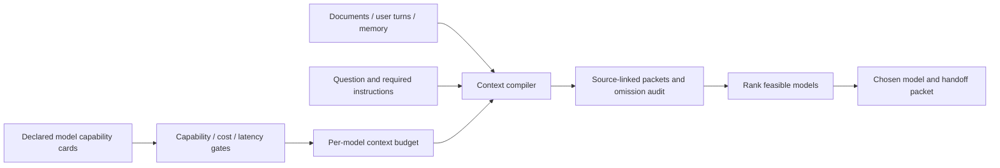

# Context summaries and model capability summaries

This first implementation turns the supplied whiteboard into an executable
context preparation layer. The board appears to propose a query routed among
models of increasing strength, task domains, source context, and a tradeoff
between quality, cost, and latency. Some labels are ambiguous. This document
records implementation choices, rather than treating every handwritten symbol
as a settled specification.

## Two separate summaries

**Model summary:** identity, description, task capability scores, limitations,
context capacity, output reserve, estimated request cost and latency, and the
origin of those declarations. These cards are data supplied by the caller;
the implementation does not infer a model's ability from its name. Scores are
suitability judgments in [0,1], not probabilities of producing a correct answer.

**Context summary:** a compact JSON packet with the question, required
instructions, selected verbatim excerpts, source references, and unresolved
structured claim conflicts. This is extractive compression. It does not yet call
an LLM to write abstractive summaries or ingest arbitrary file formats. The
caller supplies document text and model cards through JSON or the Python API.



P/W/K/M describes source identity. Model identity is a separate dimension. A
memory excerpt stays M after selection for a stronger model. Assigning source K
is a caller responsibility: the compiler cannot establish verification merely
because a document was labeled K.

## Context contract

1. Preserve the entire question and instruction list.
2. Preserve each `required_document_ids` document verbatim, including whitespace.
3. Preserve all explicitly conflicting structured claims and their references.
4. Select remaining excerpts using utility per added budget unit: lexical query
   relevance, novel query terms, and a small source-diversity bonus. Common
   English stopwords are excluded from query matching.
5. Admit an excerpt only when the complete serialized JSON packet fits.
6. Return exact source character offsets, document content hashes, a packet
   fingerprint, selected/omitted IDs, excerpt/character counts, missing query
   terms, and per-excerpt omission reasons.

Optional exact duplicate excerpts are suppressed after one copy is retained.
Matching preserves case and whitespace; it does not merge semantically similar
claims or different sources into independent support. Required material and
prerequisites are preserved even when their content repeats.

Documents can declare `"depends_on": ["definitions", "assumptions"]`. Selecting
an excerpt from that document atomically includes those prerequisite documents
and their transitive prerequisites. Every document named as a prerequisite is
kept as one verbatim excerpt, preserving code indentation and formatting. A
required document also makes its prerequisites mandatory. Unknown dependencies
and cycles are rejected. Optional excerpt bundles that cannot fit are omitted
with reason `budget_or_dependency_budget`. Claim-only references in the conflict
ledger do not automatically select excerpts or expand dependencies.

The heuristic is deterministic and untrained. It does not guarantee relevance,
semantic completeness, or truth. Documents are split on sentence endings and
line boundaries; this can lose surrounding context. Mark material as required
when exact context matters. Whole documents and structured conflicts may consume
the entire budget, in which case compilation fails with `BudgetExceeded`.
Instructions and conflicts are never silently dropped to make a model fit.

The packet contains a policy identifying excerpts and claims as untrusted data.
JSON keeps their fields structurally separate from caller instructions. This is
not a guarantee against prompt injection in a downstream model.

Conflict detection operates on explicitly supplied `claims`, for example:

```json
{"claims": {"latency_target_ms": "1500"}}
```

Two documents with the same key and different exact string values produce an
unresolved conflict. Values are not semantically normalized: `1.5 seconds` and
`1500 ms` would disagree. This is a conflict ledger, not a general natural-language
contradiction detector. It neither picks a winner nor treats repetitions as
independent support. Claim-only references can remain in a packet with no
excerpt from that document; the audit's selected and omitted IDs specifically
describe excerpt selection.

## Budgets and routing

The offline default unit is **UTF-8 bytes**, explicitly not tokens. For each
model, `input_budget = context_capacity - output_reserve`, in its declared unit.
Every packet includes JSON metadata in its measured size. The report's `payload`
is the exact budgeted string to hand off; its pretty-printed `context` field is
for inspection. Do not send the entire report to the model.

For an actual model, inject its tokenizer and choose a matching unit name:

```python
compiler = ContextCompiler(
    count_units=lambda text: len(tokenizer.encode(text)),
    unit_name="my_model_tokens",
)
```

Use that unit name on the corresponding model profile. Models using different
tokenizers should be compiled separately with their own compiler. Reserve space
for output and any provider chat/tool wrapper that is outside this JSON packet.
The CLI intentionally supports only the offline byte counter.

Routing rejects a profile when its required capabilities, estimated cost,
estimated latency, or mandatory context budget fail. Unknown cost or latency
fails a corresponding hard limit. Limits apply to caller estimates; live
spending and latency are not enforced by this offline library.

The default `quality` mode ranks feasible profiles by weighted declared capability
suitability, lexical query-term coverage, lower cost, lower latency, and model
ID. `economy` mode ranks cost first after all gates pass, and requires a known
cost estimate. Configure `min_suitability` and `min_query_term_coverage` to set
floors before ranking:

```json
{
  "capability_weights": {"coding": 0.6, "reasoning": 0.4},
  "selection_mode": "economy",
  "min_suitability": 0.75,
  "min_query_term_coverage": 0.4,
  "max_cost_usd": 0.02,
  "max_latency_ms": 1500
}
```

Coverage is the fraction of distinct non-stopword query terms found in retained
excerpts; it excludes structured claims. An empty meaningful query vocabulary
has coverage 1.0. This is a lexical diagnostic, not evidence sufficiency: synonyms
can score poorly and irrelevant text repeating query terms can score highly.
Missing weighted capabilities score zero. Missing estimates lose ties to known
estimates. With no capability weights, suitability is zero for every model. If
no model is feasible, `selected_model_id` is null with rejection reasons. The
report records the ranking rule and decision explanation.

This is an auditable baseline policy, not a learned optimal router. Retained
character fraction measures compression coverage, not answer quality. The
selection algorithm repeatedly serializes candidates to enforce exact budgets;
large document collections should be retrieved/chunked before compilation.

## Running the example

```bash
PYTHONPATH=src python3 -m knowing_where.cli.context examples/context/request.json --output examples/context/report.json
PYTHONPATH=src python3 -m unittest discover -s tests -v
```

Edit `examples/context/request.json` to supply actual text, instructions, model
cards, and routing limits. W includes user turns and web material; the demo uses
W for a current user note, not a fetched web result. The example preserves a
1500/3000 ms disagreement, compresses context for a smaller synthetic model,
and chooses a medium synthetic model. The large profile exceeds the cost limit.

The context layer does not manufacture `SourceEstimate` values or call the
existing KAP predictor on generated summaries. Query-side KAP must retain its
original leakage boundary. Downstream generation may consume these packets;
canonical answer IDs and calibrated source estimates must still be supplied
separately to the existing fusion API. Several models seeing the same excerpt
do not create several independent pieces of source evidence.

## Offline evaluation

The CLI accepts `evaluation_spans`: objects containing `document_id`, `start`,
`end`, and an optional `label`. Offsets use Python string characters, with an
exclusive end. These annotations are evaluated only after routing; they are
never supplied to the selector. Invalid annotations are rejected.

Every candidate report checks provenance and source offsets, question and
instruction retention, mandatory documents, dependencies, and structured
conflicts. With annotations it reports fully retained span recall and
length-weighted evidence-character recall. Overlapping excerpts cannot inflate
recall. With no annotations, evidence recall is null rather than an invented
score. Budget utilization and lexical coverage are reported separately.

Use `--sweep-budgets 1800 2200 2500 3200 5000` to evaluate the same request at
different byte budgets with a fixed model label. This does not change routing,
invoke models, or measure answer accuracy. See the reproducible
[demo results](../../examples/context/results.md).

## Research extensions

The next experiment is to compare full-context input, a fixed truncated
input, this extractive compiler, and an abstractive compiler on identical held-out
tasks. Measure task correctness, supporting-evidence recall, contradictory-claim
retention, instruction retention, actual tokenizer counts, latency, and cost.
Use required-evidence annotations to test whether compression removes facts
needed to answer. Tune the selector and router on training data, then report
held-out results; do not infer answer quality from compression alone.

Promising extensions are a hierarchy of claim-level and document-level summaries,
query-specific retrieval of
omitted material, and a model escalation policy triggered by unresolved evidence
or a failed answer check. These are proposed experiments, not implemented
features. The [experiment pipeline](../experiments/README.md) now connects these packets
to recorded-path generation, train-only source prediction, held-out metrics, and
conformal decisions. Actual model clients, measured capability cards, RAGAS
integration, trained routing, and live cost enforcement remain future work.
