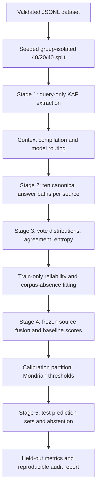

# End-to-end experiments

The experiment runner connects context preparation and routing to training,
source generation, confidence estimation, evidence fusion, conformal calibration,
and final decisions. It includes an offline replay backend, a generator interface,
a validated dataset format, and a reproducible synthetic example.

## Run the complete example

From the repository root:

```bash
PYTHONPATH=src python3 -m knowing_where.cli.experiment demo
```

The command writes five artifacts to `examples/experiments/demo/`:

- `dataset.jsonl`: 100 explicitly synthetic examples with ten recorded answer
  paths per source, query-side metadata, and separate evaluation labels.
- `models.json`: the synthetic model profile used for context routing.
- `system.json`: a portable fitted system for prediction without reference labels.
- `queries.jsonl`: three label-free synthetic inputs with recorded source paths.
- `report.json`: partitions, fitted coefficients, calibration thresholds,
  baseline comparisons, individual test predictions, and source/conflict audits.

The default experiment partitions 100 independent groups into 40 training,
20 calibration, and 40 test examples. Dataset generation uses seed 17; partitioning
and generator requests use experiment seed 42. The dataset and report carry no
claim about real model quality. Fixture paths remain fixed when the split seed
changes.

## Pipeline



Generation requests contain an example ID, question, source, chosen model ID,
instructions, and retained excerpts from that source. Gold answers, corpus-presence
labels, and calibration outcomes are excluded. Required context is handled by the
compiler before the source-specific handoff. Cross-source prerequisite documents
are preserved in the compiled packet but are not exposed as excerpts to another
source; a generator needing them must define an explicit provenance policy.

The source generator returns canonical answer IDs. Semantic answer normalization
belongs in the adapter; the runner does not assume that different answer strings
are equivalent.

## Dataset contract

Each UTF-8 JSONL line describes one example:

```json
{
  "id": "question-001",
  "question": "What is the capital of Mauritius?",
  "gold": "Port Louis",
  "group": "direct_lookup",
  "split_group": "mauritius-capital-family",
  "metadata": {
    "parametric": {"popularity_decile": 7}
  },
  "documents": [
    {"id": "knowledge-001", "source": "K", "text": "The capital of Mauritius is Port Louis."}
  ],
  "instructions": ["Return a canonical answer ID."],
  "required_document_ids": ["knowledge-001"],
  "corpus_present": {"P": true, "W": false, "K": true, "M": false},
  "paths": {
    "P": ["Port Louis", "Port Louis"],
    "W": ["Curepipe", "Curepipe"],
    "K": ["Port Louis", "Port Louis"],
    "M": ["Curepipe", "Curepipe"]
  }
}
```

This shortened illustration has two paths per source; use `--paths 2` with such a
dataset. The default experiment requires at least ten recorded paths per source.
The first requested number of paths is used without resampling. With a custom
generator, recorded `paths` can be omitted.

| Field | Contract |
| --- | --- |
| `id` | Unique, nonempty example identifier. |
| `question` | Nonempty question available before generation. |
| `gold` | Canonical reference answer, used only for supervised training labels, calibration, and evaluation. It cannot be `Ø`. |
| `group` | A fixed Mondrian group available at query time, such as task domain. Never derive it from held-out correctness. |
| `split_group` | Optional family identifier, defaulting to `id`. Related questions must share a value to prevent partition leakage. |
| `metadata` | Optional `QueryMetadata` fields: quality, parametric, web, knowledge, memory, and hops. These must be query-side observations. |
| `documents` | Optional context documents using the existing source, claims, and dependency contract. |
| `instructions`, `required_document_ids` | Optional mandatory context configuration. |
| `corpus_present` | Boolean supervision for all four sources: whether that source's corpus contains the reference answer. These labels require independent annotation. |
| `paths` | Recorded canonical answer paths per source for replay. These are outputs, not query features. |

Exact repeated questions must share `split_group`. Groups are sorted, shuffled
with the configured seed, and assigned to partitions; members of a family never
cross partitions. The first floor(0.4 × groups) groups train the model; the next
floor(0.6 × groups) minus floor(0.4 × groups) calibrate it; the remainder are test
groups. Unequal family sizes can produce row proportions different from 40/20/40.
At least five independent split groups are required.

## Training and confidence

The runner fits the existing KAP logistic heads using regularized full-batch
gradient descent. Missing-value means, missingness indicators, and feature scaling
come entirely from training examples. Exported coefficients operate on the raw
imputed features and are compatible with `LinearKAPPredictor`.

- Reliability heads use routed, corpus-present training examples and predict
  whether the source's majority answer is correct.
- Ghost heads use all routed training examples and predict corpus absence.
- Single-class subsets use a Laplace-smoothed intercept and report that fallback.
- A source with no corpus-present training examples cannot fit a reliability
  head; the experiment fails instead of inventing a calibrated estimate.

Ten generated paths produce an empirical answer distribution, majority agreement,
and entropy. Those are sampling statistics, not correctness probabilities. The
paths become one `SourceEvidence` per source; repeated samples never become ten
independent sources. Predictive vote distributions and fitted KAP source estimates
are passed separately into fusion.

## Run your own recorded experiment

Store model profiles as a JSON list using the existing `ModelProfile` fields.
An optional policy file contains a `RoutingPolicy` object.

```bash
PYTHONPATH=src python3 -m knowing_where.cli.experiment run \
  path/to/dataset.jsonl \
  --models path/to/models.json \
  --policy path/to/policy.json \
  --joint-ghost independent \
  --seed 42 \
  --alpha 0.1 \
  --paths 10 \
  --output results/experiment.json
```

Omit `--policy` to use the default quality policy. The explicit `--joint-ghost`
argument records the assumption that corpus absence is independent across sources;
its product supplies the Bayesian prior's joint ghost mass. Source-evidence
conditional independence is a separate assumption inherited from fusion. Reports
include Fréchet ghost bounds and the outside posterior evaluated at both endpoints
as a sensitivity diagnostic, not a confidence interval or an optimization result.

Routing limits operate on declared per-request estimates. A ten-path, four-source
experiment can make 40 generator calls per routed example; model cards do not
constitute aggregate experiment spending limits. Replay does not test whether a
newly selected model or a changed context would produce different recorded paths.
Record fresh traces with the actual pipeline for such comparisons.

### Download a prepared dataset

```bash
PYTHONPATH=src python3 -m knowing_where.cli.experiment download \
  https://your-dataset-host.example/dataset.jsonl \
  --sha256 <published-sha256-digest> \
  --output data/dataset.jsonl
```

The downloader requires HTTPS, a SHA-256 match, a 100 MB size limit, a 30-second
network timeout, and successful schema validation before replacing the destination.
The URL is illustrative. No real benchmark is automatically selected or downloaded.
Raw benchmark formats need a dataset-specific converter and source-presence
annotations; the runner does not manufacture those labels from gold answers.

### Connect a generator

Implement `generate(request, path_index, seed)` and supply the instance through the
Python API:

```python
from knowing_where.experiments.data import load_dataset
from knowing_where.experiments.runner import run_experiment

# models: a list of ModelProfile objects.
# generator: your adapter returning a canonical answer ID per request.
report = run_experiment(
    load_dataset("data/dataset.jsonl"),
    models,
    generator=generator,
    joint_ghost="independent",
    paths=10,
    seed=42,
)
```

The adapter owns credentials, network calls, sampling, timeouts, rate limits, and
answer normalization. Use `request.model_id` for model dispatch and `seed` for
reproducibility where supported. The CLI ships with replay; no live provider
adapter is bundled. A custom generator can also be used through the fitted-system
API described below. Custom tokenizers can be supplied through the runner's
`compiler` argument with matching model budget units.

## Mondrian sets and decisions

Each method is calibrated separately using only the calibration partition.
The nonconformity score is `1 - p(target)`. Within each fixed query-side group,
the threshold is the `ceil((n + 1) * (1 - alpha))`-th smallest calibration score.
If that rank exceeds the group's sample count, or a test group is unseen, the
threshold is infinite and the entire candidate frame is retained. There is no
silent pooled-group fallback.

The finite-sample split-conformal construction follows the approach described by
[Angelopoulos and Bates](https://arxiv.org/abs/2107.07511). Its validity requires
exchangeability within the chosen groups and a scoring pipeline fixed before
calibration. Adaptive tuning on calibration or test outcomes invalidates that
interpretation. This repository's synthetic result is not evidence of deployment
coverage or a reproduction of an unavailable project paper.

The generated frame varies by question. If the reference answer is absent from
that frame, the target is mapped to `Ø`. Reports therefore distinguish:

- **Mapped set coverage:** inclusion of the reference's frame label, possibly `Ø`.
- **Canonical answer set coverage:** inclusion of the actual reference answer.
- **Candidate recall:** whether the actual reference entered the generated frame.

Coverage of the mapped target does not establish coverage of the original answer.

Stage 5 answers only when the prediction set contains one canonical answer and no
outside option. Empty sets, ambiguous sets, sets containing `Ø`, and routing
failures cause abstention. Total Dempster–Shafer conflict also causes abstention
for the fusion methods. These decision vetoes are logged separately from set
coverage; conformal set coverage is not a guarantee on selective answer accuracy.

## Comparisons and audit

The same frozen source traces support five methods:

| Method | Scoring rule |
| --- | --- |
| `bayesian` | Existing ghost-aware Bayesian channel fusion. |
| `dempster_shafer` | Existing simple-support combination, with its pignistic transform used for set calibration. |
| `equal_sources` | Mean of the four empirical source distributions. |
| `majority` | Fraction of sources voting for each source-majority answer. |
| `parametric_only` | P source's empirical distribution. |

Total DS conflict has no valid pignistic distribution. The runner substitutes an
outside-only abstention score for evaluation, records the conflict, and forbids
an answer. It does not present the substitute as a DS probability summary.

Held-out metrics include point accuracy, candidate recall, answer and abstention
rates, selective risk and accuracy, correct-answer rate, both set coverages, mean
set size, outside-set rate, negative log likelihood, multiclass Brier score, and
10-bin expected calibration error. Probability metrics use the mapped target;
log loss is clipped at `1e-15`. Results are reported overall and by Mondrian group.

Artifacts include normalized dataset fingerprints, split membership, model cards,
training coefficients and supervision counts, calibration counts and thresholds,
test path distributions, context budget audits, source estimates, pairwise
conflicts, evidence tension, prediction sets, and decision reasons. This enables
reproducibility without turning compression or vote agreement into answer-quality
claims.

## Milestone status

| Milestone | Implemented behavior | Boundary |
| --- | --- | --- |
| Dataset acquisition | HTTPS download, checksum and schema validation, atomic replacement. | Requires a prepared JSONL URL and independently annotated source labels. |
| Seeded splits | Group-isolated 40/20/40 allocation with recorded membership. | Family annotation is the dataset owner's responsibility. |
| Training | Train-only imputation and regularized logistic KAP fitting. | No trained model router or engagement gate. |
| Stage 2 generation | Ten paths per source through an injectable generator; recorded-path backend included. | No bundled live model client. |
| Stage 3 confidence | Empirical vote distributions, agreement, and entropy. | No claim that self-consistency equals correctness. |
| Stage 4 fusion | Existing Bayesian and DS rules connected to source outputs. | Independence assumptions remain explicit. |
| Baselines and evaluation | Five-method comparison, held-out probability, decision, and coverage metrics. | Real benchmark results require actual annotated data and traces. |
| Stage 5 decisions | Group-specific conformal sets, singleton answers, abstention, conflict vetoes. | Validity depends on exchangeability and a frozen pipeline. |

The original project reference was described as *Knowing Where Not to Look:
query- and source-resolved confidence for agents* (November 11, 2026). Its full
text is not included in this repository. The additions above are documented
implementation choices, not a claim of exact reproduction of unspecified stages.

## Reusable fitted systems

Version 0.2 adds a prediction path that needs no ground-truth labels. The demo now
also writes `system.json` and `queries.jsonl`. The latter is a small label-free
slice of the synthetic fixture for demonstrating inference; it is not an
additional independent benchmark.

```bash
PYTHONPATH=src python3 -m knowing_where.cli.experiment demo

PYTHONPATH=src python3 -m knowing_where.cli.experiment predict \
  examples/experiments/demo/system.json \
  examples/experiments/demo/queries.jsonl \
  --max-calls 120 \
  --output results/predictions.json
```

A fitted system stores model profiles, routing policy, training-only coefficients
and imputations, generation settings, and frozen calibration thresholds. It
excludes reference answers, source-presence labels, recorded paths, and test
predictions. A SHA-256 fingerprint detects accidental modification; it is not a
signature or proof of trusted provenance. Loading validates predictor features,
all four source heads, and calibration threshold consistency.

Export a system from a current experiment report:

```bash
PYTHONPATH=src python3 -m knowing_where.cli.experiment export \
  examples/experiments/demo/report.json \
  --output results/system.json
```

Alternatively, pass `--artifact-output results/system.json` to `run`. Version 1
reports must be regenerated before export. Version 2 experiment reports are
separate from version 1 fitted-system artifacts and version 1 prediction results.

For the Python API:

```python
from knowing_where.experiments.data import load_queries
from knowing_where.experiments.system import FittedSystem

system = FittedSystem.load("results/system.json")
predictions = system.predict(load_queries("data/queries.jsonl"), max_calls=120)
```

Prediction JSONL uses the query fields from the dataset contract, excluding
`gold`, `corpus_present`, and `split_group`. Labeled examples are rejected by the
prediction parser and API. Replay still needs recorded `paths`; a custom generator
can provide new outputs without those paths. Pass it as `generator=` to `predict`.

Changing the generator's fully qualified class identity is rejected because it
changes the calibrated pipeline. Class identity alone cannot detect a changed
provider model revision, prompt implementation, sampling settings, or distribution.
Keep those fixed yourself and run a new calibration experiment when they change.
Changing test questions never refits coefficients or thresholds. Unseen groups
retain the full candidate frame and abstain conservatively.

## Reliability and run controls

- `--max-calls` caps total backend attempts across the entire run or prediction
  batch. The full initial call plan is checked before generation starts. Retries
  consume the same budget and cannot overrun it.
- `--max-retries` retries timeout and connection errors with a capped exponential
  delay, preserving the request, path index, and seed. It defaults to zero;
  invalid requests and answers are not retried. The adapter must still enforce
  its own network timeout; retry control cannot interrupt a stuck adapter.
- Replay inputs are checked for sufficient valid paths before processing. Routed
  training supervision is checked before issuing generator calls.
- Training finishes before calibration and test generation. Fitted coefficients
  are frozen before either partition is used for scoring.
- Training scales finite features before centering to avoid overflow and assigns
  zero weights to constant columns. Fit audits include epochs and training log
  loss; that loss is not held-out performance.
- Source requests now retain source-specific excerpt offsets, document metadata,
  relevant structured claim references, and the evidence policy. Claims from
  another source are not exposed as support for the requested source.
- Strict input parsing rejects duplicate JSON keys, nonfinite literals, unknown
  query fields, malformed containers, fractional hop keys, and normalized hop-key
  collisions. Dataset errors identify the input file and line.
- Reports and fitted artifacts use atomic replacement. CLI output destinations
  must be distinct from input files, preventing accidental input overwrites.

Generation telemetry reports planned attempts, actual attempts, and retries.
Metrics additionally expose answered/correct counts, routing success, coverage
restricted to routed examples, decision-reason counts, and set-size histograms.
A quality summary identifies excluded training examples, unseen test groups,
calibration groups forced to retain the full frame, and methods answering no test
questions. These diagnostics make abstention and routing failures visible rather
than interpreting high mapped coverage alone as success.

Contradictory deterministic sources can assign zero Bayesian likelihood to every
prior-supported answer. The fusion API raises `ImpossibleEvidenceError`, a
`ValueError` subclass. The experiment and inference layers record
`bayesian_status: zero_evidence`, use an outside-only decision score, and retain
total-conflict diagnostics so the fusion methods abstain. The substitute is not a
Bayesian posterior; undefined evidence tension and endpoint diagnostics are null.

## Predictive uncertainty diagnostics

Version 0.3 adds per-method entropy, normalized dispersion, effective candidate
count, top-two margin, variation ratio, and outside score. Source audits decompose
equal-mixture entropy into within-source ambiguity and between-source disagreement
and include Bayesian source-removal sensitivity. Comparisons also include held-out
point-prediction risk/coverage curves. These calculations use no additional
generator calls and do not change fitted decisions. See the
[uncertainty methodology](../uncertainty/README.md) for formulas and limits.
